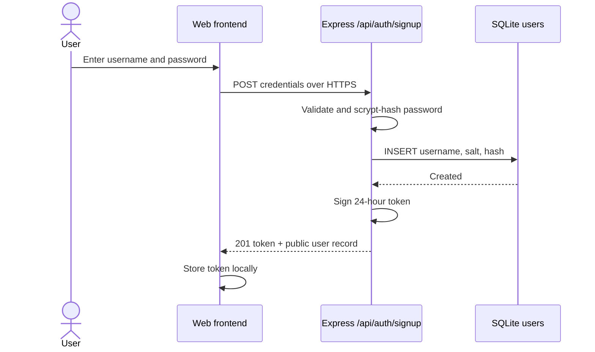
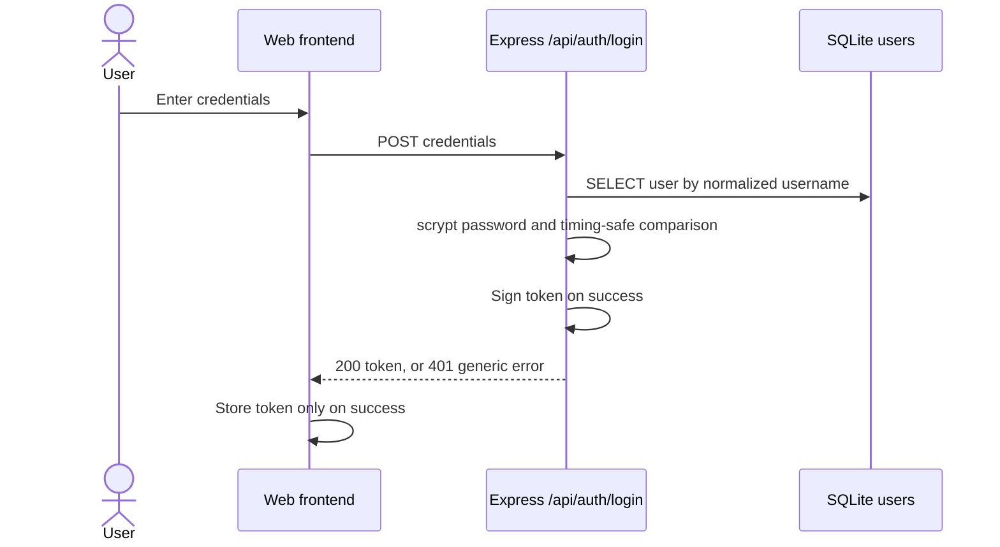
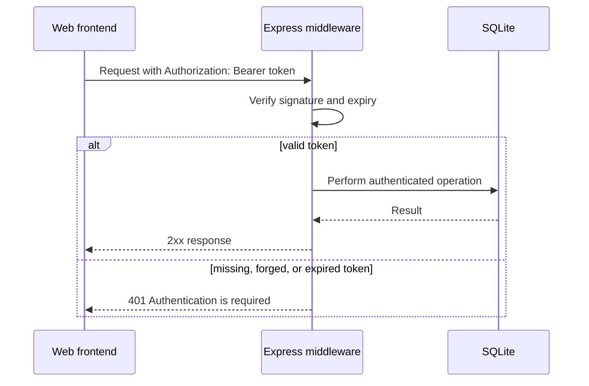

# TE6 access-control design

The API uses account credentials only for authenticated actions; public bathroom discovery remains readable. Passwords are salted and hashed with Node's built-in `crypto.scryptSync`. Tokens are HMAC-SHA256 signed, expire after 24 hours, and are stored by the web client in local storage. Set `AUTH_TOKEN_SECRET` to a private deployment secret.

## Sign up

## Sign in

## Protected request

